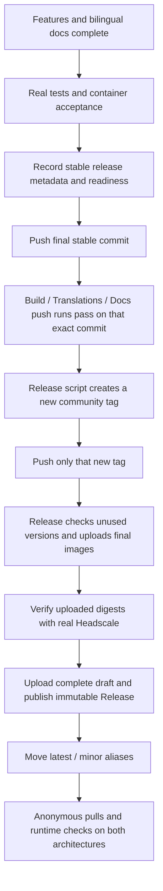

# Headplane community fork: maintenance and session handoff

[简体中文](./MAINTENANCE.zh-CN.md) · [Project rules](./AGENTS.md) · [Release and credentials guide](./.github/FORK_SETUP.zh-CN.md)

Verified on 2026-11-22. Start future sessions here for feature work, upstream upgrades, translation, builds, releases and recovery. Versions, commits and acceptance results below are a dated snapshot. Check the repository and GitHub again before acting.

## 1. Start a new session

Paste this into a new session and supply the task:

```text
Project: E:\code\headplane.
Read AGENTS.md, MAINTENANCE.md (or MAINTENANCE.zh-CN.md), and .github/FORK_SETUP.zh-CN.md.
Check the branch, worktrees, staged/unstaged changes, latest Release and relevant CI.
Preserve existing changes. Never commit production configuration or credentials from ydzw.
Keep main/stable as the two long-lived branches, complete English/Chinese support,
the upstream license and the unofficial attribution.
Execute routine terminal commands and reversible development work without asking
for confirmation for each command; follow the current task's instructions.
Keep the release gates. Do not create a release or deploy production without a
clear task to do so.
Record changes, validation, source commits, release status and next steps in this manual.

Current task: ...
```

Read in this order:

1. `AGENTS.md`: development, errors, testing and community release constraints.
2. This manual: current state and operating procedures.
3. `.github/FORK_SETUP.zh-CN.md`: workflows, permissions, publishing and recovery.
4. `.github/fork-release.json`: upstream base, channel and community version for the **current branch**.
5. `.github/I18N_AUDIT.zh-CN.md`: translation audit and selected fingerprint review.
6. Relevant code, tests and feature docs. On `main`, read `app/server/ARCHITECTURE.md` and `tests/README.md` for server work. Use stable's own layout instead of assuming the newer harness exists there.

Explicit current instructions can change an earlier design; update the rules and docs together. Authorization cannot remove an actual execution-environment restriction. Report the source of a real blocker instead of claiming an action succeeded.

## 2. Project and release snapshot

| Item                           | Verified state                                                                                                                                                                                                      |
| ------------------------------ | ------------------------------------------------------------------------------------------------------------------------------------------------------------------------------------------------------------------- |
| Community repository           | <https://github.com/laity-cqf/headplane-zh-cn>, a real upstream fork                                                                                                                                                |
| Upstream                       | <https://github.com/tale/headplane>                                                                                                                                                                                 |
| Identity                       | Unofficial English/Simplified Chinese fork; preserve `LICENSE`, copyright and README attribution                                                                                                                    |
| Latest community release       | [v0.8.4-zh](https://github.com/laity-cqf/headplane-zh-cn/releases/tag/v0.8.4-zh), published with `immutable=true`                                                                                                   |
| Final image                    | `ghcr.io/laity-cqf/headplane-zh-cn:v0.8.4`                                                                                                                                                                          |
| Platforms                      | `linux/amd64`, `linux/arm64`; publish only the `final` image                                                                                                                                                        |
| Image digest                   | `sha256:9cee931c497ca816e731eb36491c2efee90baa5a1bfe5e5cefdc20dc01a21533`                                                                                                                                           |
| Released source                | `28b94da361b005b1d8bca7d42ac0f3c1f4192a07`, from `stable`                                                                                                                                                           |
| Upstream base for that release | Headplane `v0.8.2`, commit `05e3ee33f6d3b347013654c69186791347be8bd9`                                                                                                                                               |
| Acceptance evidence            | [Release 45014011501](https://github.com/laity-cqf/headplane-zh-cn/actions/runs/45014011501) passed, including both architectures, anonymous pulls, real Headscale, both sign-in languages and authenticated access |
| Moving aliases                 | `latest` and `0.8` matched this digest at publication; later releases may move them                                                                                                                                 |
| Previous releases              | Preserve `v0.8.2-zh`, `v0.8.3-zh`, their original images and attachments                                                                                                                                            |

Keep three versions distinct: **community Headplane image**, **actual upstream Headplane base**, and **connected Headscale server**. Community 0.8.4 does not claim an upstream Headplane 0.8.4 release and does not upgrade Headscale. Tailscale clients and Dex have separate versions too.

The peeled Git tag commit, `release-manifest.json`, and acceptance run's `headSha` identify released source. GitHub's Release `target_commitish` may display default branch `main`; it does not prove that the release was built from `main`.

## 3. Established maintenance decisions

Headplane manages the network through Headscale APIs/mounted configuration. Headscale is the control service, Tailscale the client, Dex an optional OIDC identity provider, and DERP a data relay. Dashboard maintenance does not mean changing or upgrading all these components. Test OIDC against isolated Dex rather than production credentials.

- Keep only `main` and `stable` as long-lived branches. Temporary feature/sync PR branches are allowed and deleted after merge. Do not introduce a permanent `release/0.8` branch.
- `main` follows upstream development, always with `channel=development` and `publicationReady=false`. It cannot publish. `stable` merges the newest non-prerelease upstream tag while retaining translations and community features.
- Preserve upstream history with ordinary merge commits for sync PRs. Do not force-push over translations or copy a whole development UI, dependency set or harness into stable.
- Maintain complete English/Chinese UI and docs. Keep technical fields, original diagnostics and remote terminal output in their original language.
- Full Docker tags are `vX.Y.Z`, without `-zh`. Git/GitHub tags are `vX.Y.Z-zh`, without revision suffixes. Full tags are immutable; `latest` and minor aliases may move.
- Normally follow upstream versions. An explicitly requested early community maintenance release uses `communityRelease`: a higher unused patch in the same upstream minor. Keep `package.json` at that branch's real upstream version.
- Keep exactly five workflows: Build, Translations, Docs, Upstream sync and Release.
- No debug image publication, Cloudflare/other hosted docs deployment or documentation hosting credentials. Retain docs as source, local previews, temporary CI artifacts and bilingual Release snapshots.
- This machine's main directory is `E:\code\headplane`. `.cache\release-0.8` is the `stable` worktree, merely a directory name rather than a release branch.
- `ydzw` contains local production deployment material. Never upload its configuration, databases, keys, OIDC secrets or certificates. Reinspect current deployment state instead of assuming old chat details still apply.

## 4. Initial checks

Commands below use PowerShell at the repository root. Confirm tools are available; temporary tool caches are not permanent interfaces.

```powershell
Get-Command git, gh, node, pnpm
git status --short --branch
git diff --stat
git diff --cached --stat
git worktree list
git remote -v
git log -5 --oneline
Get-Content .github/fork-release.json
gh auth status
gh api user --jq .login
gh release view --repo laity-cqf/headplane-zh-cn --json tagName,url,publishedAt
```

Record staged, unstaged and untracked changes before choosing a checkout. Do not use `git reset --hard`, `git clean -fd`, blanket `git add .` or automatic configuration replacement. Stage explicit files and inspect the commit for unrelated work.

After confirming remote identities:

```powershell
git fetch origin main stable
git fetch upstream main --tags
git log --oneline HEAD..origin/main
gh pr list --repo laity-cqf/headplane-zh-cn --state open
gh issue list --repo laity-cqf/headplane-zh-cn --label upstream-sync --state open
```

For a new clone, add `upstream` as `https://github.com/tale/headplane.git` if absent. Use `git worktree list` to find an existing stable checkout. Only create another when absent, for example `git worktree add .cache/stable stable`. Do not modify the same branch in multiple directories.

Query upstream Releases again in each session. Headplane upstream is `tale/headplane`; Headscale upstream is `juanfont/headscale`.

## 5. Branch differences and code entry points

| Area                       | `main`                                                                                    | Current `stable` 0.8 line                                                                                     |
| -------------------------- | ----------------------------------------------------------------------------------------- | ------------------------------------------------------------------------------------------------------------- |
| Purpose                    | Upstream development and forward compatibility                                            | Formal delivery and maintenance                                                                               |
| Package snapshot           | `0.8.1`, inherited development value; not the published community version                 | `0.8.2`, actual upstream base                                                                                 |
| Documentation              | Fumadocs/React Router: `docs/features/*.mdx` and `*.zh-CN.mdx`                            | VitePress: `docs/features/*.md` and `docs/zh-CN/features/*.md`                                                |
| Navigation                 | Folder `meta.json` and Chinese counterparts                                               | `docs/.vitepress/config.ts` and bilingual pages                                                               |
| Canonical Headscale matrix | `tests/harness/versions.ts`                                                               | `tests/integration/setup/env.ts`                                                                              |
| Current canonical versions | `0.27.1`, `0.28.0`, `0.29.7`                                                              | `0.27.0`, `0.27.1`, `0.28.0`, `0.29.0`, `0.29.1`, `0.29.7`                                                    |
| Integration setup          | `tests/harness/`; latest locally, `HP_HEADSCALE_VERSIONS=all` for all                     | Native `tests/integration/setup/` and explicit projects; do not apply main's environment selection convention |
| Config application         | Current proc/Kubernetes restart behavior requires a supervisor/kubelet to restore service | Docker restarts; proc/Kubernetes SIGHUP does not apply new startup settings, so restart fully by hand         |

These are accepted versions, not an automatic guarantee about future patches. Some stable Agent scenarios have additional version coverage. Read the relevant files instead of deleting their scenarios to match the canonical matrix.

| Work                                      | Read first                                                                                                                          |
| ----------------------------------------- | ----------------------------------------------------------------------------------------------------------------------------------- |
| Server API/version behavior               | `app/server/headscale/api/`, especially `capabilities.ts`, `resources/policy.ts`, `resources/auth.ts`                               |
| ACL/Grants parsing and field preservation | `app/utils/acl-policy.ts`, `app/utils/policy-extensions.ts`                                                                         |
| Rules, app grants, SSH, subnet gateways   | `app/routes/acls/`: `dialogs/grant.tsx`, `dialogs/ssh-rule.tsx`, `components/extensions-editor.tsx`, `components/subnet-routes.tsx` |
| Subnet grouping                           | `app/utils/subnet-routes.ts`                                                                                                        |
| Server settings/validation                | `app/routes/settings/control.tsx`, `control-actions.ts`, `app/utils/headscale-settings.ts`                                          |
| Auth decisions                            | `app/routes/settings/auth-requests.tsx`                                                                                             |
| Translations                              | `app/i18n/en/`, `app/i18n/zh-CN/`, `app/i18n/messages.ts`                                                                           |
| Config/OIDC/roles/actions                 | `app/server/config/`, `app/server/oidc/`, `app/server/web/`                                                                         |
| Agent/SSH WASM/healthcheck                | `cmd/`, `internal/`, `build.sh`, `Dockerfile`                                                                                       |
| Sync, publication and recovery            | `.github/workflows/`, `.github/scripts/`                                                                                            |

Matching filenames can still use different actions, contexts and test interfaces. Compare implementations before porting changes between branches.

## 6. Delivered features and boundaries

0.8.3 added JSON/HuJSON `acls`, `grants` and mixed policies, multiple sources/destinations, protocol/port entries, `via`, and the subnet gateway list. 0.8.4 retains them and adds:

| UI entry                                 | Controls and limits                                                                                                             |
| ---------------------------------------- | ------------------------------------------------------------------------------------------------------------------------------- |
| Access Control → Headscale 0.29 features | `nodeAttrs`, `randomizeClientPort`, `tests`, `sshTests`                                                                         |
| Access Control → Rules → Grants          | Application `app` JSON, read-only Taildrive and Peer Relay presets; new grants have no default IP permission                    |
| Access Control → SSH rules               | `check`, reauthentication period, `acceptEnv`; forwarding requires Headscale 0.29.7+ and Tailscale 1.104.4+ on SSH destinations |
| Access Control → Preview rules           | `/api/v1/policy/check` without saving; network/SSH assertion diagnostics, including failed saves reported as HTTP 500           |
| Settings → Headscale settings            | Default node expiry, ephemeral cleanup, subnet HA probe interval/timeout, client auto-update default, Taildrop                  |
| Settings → Authentication approvals      | Manual approval/rejection by full request ID; no upstream pending queue or requester lookup API                                 |

Preserve these behaviors:

- Saving requires database policy mode and policy permission. File mode remains read-only; never silently change storage mode. Policy validation is not a real network reachability test.
- Structured edits preserve unrelated/unknown fields and explicit empty rules, but serialization removes HuJSON comments. Use the file editor to retain handwritten comments.
- Hidden UI is not a permission boundary. Actions independently check permissions, version, input, writable configuration and stale forms; expected failures use `ActionError`.
- Headscale 0.29 registration uses JSON `/api/v1/auth/register`; older versions keep their native API. Node ownership is immutable from 0.28 onward.
- Server settings require permission and writable Headscale YAML. Environment variables may override file values. Full restart requirements differ by branch/integration.
- Headscale's built-in ephemeral inactivity default is `120s`; `30m` in an example is not that default. HA interval/timeout defaults are `10s`/`5s`; verify definitions for the connected version before changing behavior.
- Same-subnet failover requires multiple approved gateways advertising the same prefix and reaching the same LAN destinations. Probes do not check every business server; `via` does not mean arbitrary load balancing.
- Taildrive filesystem shares and Peer Relay listeners still require client setup. Taildrop and Taildrive are separate features.
- Gate unsupported operations on older Headscale versions. Do not invent APIs to fill a form. Unsupported Funnel and `nodeAttrs.ipPool` presets are not offered.

Each branch's Headscale 0.29 feature guide contains usage details; see the documentation paths above.

## 7. Feature work procedure

1. Identify the target: stable production delivery, development, or both. Assess both branches for common fixes while retaining their architectures.
2. Verify behavior against the real Headscale API, release notes or config definitions, with explicit version and permission boundaries.
3. For a bug, write the failing test first at the lowest reproducing layer. Add feature tests only for plausible regressions, not assertions copying implementation.
4. Update parsing/API, actions and forms. Server validation must work independently of the UI. Centralize version differences in `capabilities.ts`.
5. Preserve unknown policy fields, old configs, permissions and language-switch drafts. New grants must not silently broaden access.
6. Ship English/Chinese messages, docs and CHANGELOG together. Put operator upgrade steps in `Upgrading`.
7. Format, review selected translations, run unit/relevant integration tests and merge. Publication is separate under section 11; merged does not mean released.

## 8. Translation and documentation review

```powershell
pnpm i18n:check
pnpm i18n:review --message 'message.key'
pnpm i18n:review --file 'docs/features/headscale-029.mdx'
pnpm i18n:check
```

The file example is for `main`; stable uses `docs/features/headscale-029.md`. Review meaning, placeholders, configuration keys, commands, links and anchors before recording selected entries. Repeat arguments as needed. When deleting English sources, remove Chinese counterparts and select the old key/path to remove stale records.

`.github/i18n/reviewed.json` contains review fingerprints, not translations. Do not rebuild all fingerprints, delete the baseline or widen exceptions to bypass review. `check` writes nothing and cannot prove semantic or dynamic-interface completeness.

On stable also run `node scripts/i18n/release-status.mjs` and `pnpm i18n:release` for `.github/i18n/scope.json` completeness. Do not invent equivalent commands on main when absent.

These two root manuals are maintained together by human review. Current automatic document pairing covers README, CHANGELOG and docs-site pages; **it does not automatically cover the root manuals**. Update both manuals and review them explicitly. Do not claim automatic coverage or add exceptions for them.

## 9. Upstream and Headscale upgrades

### Headplane upstream sync

Upstream sync checks around 09:27 Asia/Shanghai daily, subject to scheduler delays. It creates `main`/`stable` sync PRs and a translation tracking Issue assigned to the maintainer. It does not merge, finish translations or publish. Watch/Issue subscriptions determine notification delivery.

```powershell
gh api repos/tale/headplane/releases/latest --jq '{tag: .tag_name, published: .published_at}'
gh workflow run sync-upstream.yaml --ref main --repo laity-cqf/headplane-zh-cn
gh pr list --repo laity-cqf/headplane-zh-cn --state open
```

After an update:

1. Check the real source branch/tag and diff. Prefer the PR containing the newest upstream commits.
2. Merge upstream history normally. Resolve conflicts while retaining bilingual resources, docs, five workflows, unofficial notices and immutable release rules.
3. On stable, record the actual upstream version/40-character commit and reset `publicationReady=false`. Clear or deliberately rebuild `communityRelease` for the new base; do not leave it bound to the old commit.
4. Check used image/Git tags. If the upstream version collides with an already published community maintenance version, explicitly select a higher unused community patch under the rules. Never overwrite it.
5. Retain upstream's native Node/pnpm/Go/UI/harness and matrix; complete translation, adaptation, docs and migration instructions.
6. If dependencies/lockfiles change, check the Nix PNPM hash. Complete CI before recording readiness and following the release procedure.

Main remains development. Its recorded upstream release base need not be the current upstream development tip; inspect merge history, sync PRs and actual upstream commits to determine progress.

### Headscale server upgrades

Treat this as a separate task. Check `juanfont/headscale` for the target stable release, config differences, database migrations and supported Tailscale clients. Test real API contracts and expand the branch's canonical matrix/CI when necessary.

Before production upgrades, back up the Headscale database/volumes, config, policy and relevant Dex config; check route approvals and failover. Rolling back the dashboard is not rolling back a database migration. Never assume an old server can safely open a new database. Follow the current deployment task and maintenance window.

## 10. Local builds and testing

Both branches currently require Node `>=24.2 <25`, pnpm `>=10.4 <11`, with `packageManager=pnpm@10.4.0`. Read the branch's `package.json` after upgrades. Read Go requirements from `go.mod`/Dockerfile. Container tests require working Docker. Do not change engines merely to fit an old local toolchain.

```powershell
pnpm install --frozen-lockfile
pnpm format <changed-files>
pnpm lint
pnpm typecheck
pnpm test:unit
node --test .github/scripts/*.test.cjs
pnpm i18n:check
pnpm docs:build
git diff --check
```

Replace `<changed-files>` with the explicit changed file list. Documentation-only work still runs unit tests, translation checks and relevant docs builds. Do not add implementation-mirroring tests for reversible wording changes.

Run `pnpm test:integration` for route, Headscale client, Agent, platform or OIDC changes. For main's complete matrix:

```powershell
$env:HP_HEADSCALE_VERSIONS='all'
pnpm test:integration
Remove-Item Env:HP_HEADSCALE_VERSIONS
```

Stable uses its own projects/matrix. If Docker is unavailable, report local integration tests as unrun and inspect real GitHub Actions results on the same source commit. Do not substitute fake Headscale, empty tests or a reduced matrix.

Linux/WSL/CI full builds use `./build.sh --skip-pnpm-prune`, including the app, Agent, SSH WASM and healthcheck. Windows `pnpm build` builds the app only and cannot replace full packaging acceptance.

Only build local candidate images where Docker is available and the context has been checked for production material:

```powershell
docker build --target final --build-arg HEADPLANE_VERSION=local --build-arg IMAGE_TAG=headplane-zh-cn:local -t headplane-zh-cn:local .
```

Do not push a local candidate to a formal full version. Use isolated config and real test Headscale, not production volumes or services. `.gitignore` does not replace `.dockerignore`; use a clean checkout/CI without production material for builds.

## 11. Formal release procedure



### 11.1 Version and bilingual release notes

Publish from a clean `stable` checkout. In `.github/fork-release.json`, default to `upstream.version`. For an explicitly requested community maintenance release, set `communityRelease.version`, matching `upstreamCommit`, and nonempty `en`/`zh-CN` notes. Keep the package's actual upstream base.

Notes must identify controls and UI locations, version/permission conditions, restart/configuration steps, actual upstream base, tested matrix and image. Do not describe forms as automatically deploying client services or changing network paths.

Update README, deploy examples, bilingual feature docs and CHANGELOG. Operator steps belong in `Upgrading`. Preserve attribution/license. Record `publicationReady=true` after acceptance; it never replaces CI.

### 11.2 Exact final stable checks

```powershell
$hpSha=git rev-parse HEAD
gh run list --repo laity-cqf/headplane-zh-cn --branch stable --event push --commit $hpSha --json databaseId,name,status,conclusion,headSha,url
node .github/scripts/fork-release.cjs info
git status --porcelain
```

Build, Translations and Docs must all be successful **push runs on the final same SHA**. PR results, old commits, partial success or workflow_dispatch alone do not satisfy the current script. A later edit changes the SHA and requires another check.

Stable may be ahead of its last release. Old metadata or a retained `publicationReady=true` does not permit publishing the old full version again. `v0.8.4` is already used and must never be recreated/rebuilt as a full version.

### 11.3 Tag and publication

```powershell
node .github/scripts/fork-release.cjs tag
```

Read the **new tag** printed by the script and run only `git push origin refs/tags/<new-community-tag>`. Do not reuse the historical `v0.8.4-zh` in this manual. Do not use `pnpm release cut`, blanket `git push --tags`, force pushes or manual full-image replacement.

```powershell
gh run list --workflow release.yaml --repo laity-cqf/headplane-zh-cn --limit 5
gh run view <release-run-id> --repo laity-cqf/headplane-zh-cn
```

The four attachments are `docs-root.tar.gz`, `docs-archive.tar.gz`, `release-manifest.json`, `SHA256SUMS`. Use GitHub's built-in ZIP/tar.gz source archives; no duplicate `source.tar.gz`. Published full tags/assets are locked, and doc hotfixes do not overwrite old snapshots.

Done means public immutable Release, complete notes/assets, correct image digest/platforms, aliases following version order, and successful anonymous pulls/real runtime on both architectures. An uploaded image alone is not a completed release.

## 12. Recovery and troubleshooting

Inspect original logs, tag, Release/draft, image existence and digests before choosing a recovery path.

| State                                                                    | Action                                                                                                                                    |
| ------------------------------------------------------------------------ | ----------------------------------------------------------------------------------------------------------------------------------------- |
| Validation/build failed before a full image was uploaded                 | Fix and revalidate; do not casually move an existing tag. Choose a new version or recover the original run as its state allows            |
| Full image uploaded, original publishing job never ran, no draft/Release | Use `recover` with the original run ID/tag; do not rebuild the full image                                                                 |
| A draft or partial attachments already exist                             | Inspect original state; automated recovery refuses. Do not delete, clobber or blindly republish                                           |
| Immutable Release exists, alias update failed                            | Restore only moving aliases to the published digest after checking it is still the newest relevant release. Do not rerun Release creation |
| Release exists, anonymous verification failed                            | Check GHCR Public visibility, network and digest; run `verify`, not a rebuild                                                             |
| Full image exists or a post-publication bug is found                     | Preserve it and explicitly choose the next unused version                                                                                 |

Replace placeholders before running verification or eligible upload recovery:

```powershell
gh workflow run release.yaml --ref stable --repo laity-cqf/headplane-zh-cn -f operation=verify -f tag=<existing-community-tag>
gh workflow run release.yaml --ref stable --repo laity-cqf/headplane-zh-cn -f operation=recover -f tag=<original-community-tag> -f original_run=<original-run-id>
```

`short-tag` adds short tags to historical images; it does not create a new version and refuses a different existing digest. Read guards in `.github/scripts/recover-release.cjs`, `published-assets.cjs` and `short-image-tag.cjs`.

Other cases:

- Missing/expired CLI credentials: inspect `gh auth status` and `gh api user`, including actual target permissions. Keep credentials in GitHub/credential management, never docs/logs/commits. Old displayed account names do not establish current API identity.
- A default `GITHUB_TOKEN` push did not trigger CI: configure a repository-scoped `UPSTREAM_SYNC_TOKEN`, or have appropriately authorized maintainer credentials push a necessary follow-up change to produce final-SHA push CI. Workflow_dispatch alone is insufficient for the current preflight's `event=push` condition; do not bypass it.
- Workflow sync push rejected: check Workflows/Contents/PR/Issues permissions. Do not remove workflow changes to hide the error.
- Transient Docker Hub/GHCR errors: inspect state/logs, then retry only safe failed steps. Network, 401/403/429 and 5xx responses never mean an image version is unused.
- Nix dependency hash mismatch: inspect dependency/lock changes and use Upstream sync's Nix hash process. Do not invent hashes or remove checks.
- Windows Node certificate-chain errors: inspect system CAs/proxy settings; use `--use-system-ca` where appropriate. Never set `NODE_TLS_REJECT_UNAUTHORIZED=0` or disable TLS validation.
- Unrelated staged files: isolate current work and inspect file lists/diffs before committing; never include the whole existing index automatically.

## 13. Credentials, docs and production

| Item                                 | Location/purpose                                                                                   |
| ------------------------------------ | -------------------------------------------------------------------------------------------------- |
| GitHub CLI login                     | Local credential management for repository/PR/Actions operations                                   |
| Actions `GITHUB_TOKEN`               | Temporary job authorization; Release declares packages/contents/attestations permissions as needed |
| Optional `UPSTREAM_SYNC_TOKEN`       | Repository Actions Secret for workflow pushes and subsequent CI triggers                           |
| GHCR visibility                      | Public for anonymous pulls; do not embed GitHub tokens in Compose                                  |
| Headscale API key/OIDC client secret | Production config or secret files; never Git, release assets or screenshots                        |
| Documentation hosting credentials    | Not needed; do not create                                                                          |

`ydzw` is private deployment analysis material, not a ready-to-publish template. Inspect both `.gitignore` and `.dockerignore`; ignoring a path does not untrack it. If production files are already tracked, stop spreading them and handle the issue separately without rewriting history unasked.

For production dashboard updates, pin a full published tag/digest and retain Headplane config/data volumes. Distinguish panel updates from Headscale migrations. Recreate only the intended service, not volumes. A repository release does not prove the user deployed it.

Preview `docs-root.tar.gz` at `/` and `docs-archive.tar.gz` at its minor path, such as `/0.8/`, through a local static server. No Cloudflare deployment is needed.

## 14. Pending work and session records

Handoff baseline: 0.8.4 is published with complete acceptance. This manual is a new branch-source change; **it is not inserted into the locked 0.8.4 image/docs attachments**. Package later branch changes with the next explicitly requested release.

2026-11-22 manual update: added both manuals and README/AGENTS entry points, and corrected the release guide's current version and push-CI requirement. Local unit tests passed: 325 on main and 307 on stable. Both translation checks and docs builds passed, as did stable's release translation-scope checks. This change only touches docs/review records; no new local container tests, image publication or production operations were performed. Use the pushed commit's GitHub Actions records for its subsequent CI results.

The user deferred direct-connect network troubleshooting. Do not reopen it as a development task unless requested. The reported client-to-gateway path uses self-hosted DERP; this alone does not prove UDP is blocked. Disabling local firewalls does not guarantee NAT traversal. Do not promise that ACL edits, random ports or a panel upgrade will fix direct connectivity.

At each completed stage, record the following here or in the related Issue/PR, and keep key status in both manuals aligned. Exclude credentials, full production configs and secret-bearing logs.

```text
Date / task:
Target branch and working directory:
Actual changes and compatibility boundaries:
Source commit / PR:
Local validation: commands/results; unrun checks and reasons:
CI: exact SHA, run URL, conclusion:
Release: not released / in progress / published; Git tag, image tag, digest, platforms:
Production: untouched / explicitly executed scope:
Unresolved issues and material risks:
Next action and completion conditions:
```

Before handoff, confirm traceable files, preserved user changes, matching bilingual explanations, no production-file leaks, no unnecessary temporary branches, and a clear distinction between documentation, branch state and published state. A new session should continue using the repository and these links without recovering old chats.
