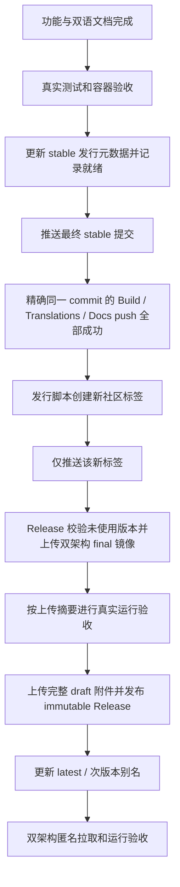

# Headplane 中文维护版：维护与会话交接手册

[English](./MAINTENANCE.md) · [项目规则](./AGENTS.md) · [发行与凭据说明](./.github/FORK_SETUP.zh-CN.md)

核对日期：2026-11-22。本文是后续会话的项目入口，覆盖功能优化、上游升级、汉化、构建、发行和恢复。版本、提交和验收记录是该日期的快照；每次开始工作时重新核对仓库与 GitHub，不能把快照当成实时状态。

## 1. 新会话从这里开始

将下面这段话复制到新会话，并补充本次任务：

```text
项目路径：E:\code\headplane。
先阅读 AGENTS.md、MAINTENANCE.zh-CN.md 和 .github/FORK_SETUP.zh-CN.md。
检查当前分支、worktree、暂存与未暂存改动、最新 Release，以及本次相关 CI。
不要丢弃已有修改，不要提交 ydzw 中的生产配置或凭据。
保持 main/stable 两条长期分支、中英双语、上游许可证与非官方来源声明。
常规终端命令和可逆开发操作直接执行，不需要逐项询问；按本次要求推进。
构建和发布遵循现有门禁；没有明确发布任务时不创建新发行或部署生产环境。
完成后记录变更、验证结果、源码提交、发行状态及下一步，更新这份手册。

本次任务：……
```

按这个顺序读取：

1. `AGENTS.md`：开发、错误处理、测试及社区发行约束。
2. 本手册：当前状态、工作步骤与交接要求。
3. `.github/FORK_SETUP.zh-CN.md`：工作流、权限、发行和恢复细节。
4. `.github/fork-release.json`：**当前分支**记录的上游基础、通道及社区版本。
5. `.github/I18N_AUDIT.zh-CN.md`：翻译检查范围与指纹复核方法。
6. 涉及的代码、测试和功能文档。`main` 服务端先读 `app/server/ARCHITECTURE.md` 与 `tests/README.md`；`stable` 使用自己的原生目录，不能假设它具有开发线的新测试框架。

若本次明确要求覆盖或改变旧方案，以本次要求为准，同时更新规则和文档。授权不改变运行环境本身的权限限制；遇到真实限制时说明来源，不能虚构执行成功。

## 2. 项目身份和版本快照

| 项目           | 已核对的状态                                                                                                                                                  |
| -------------- | ------------------------------------------------------------------------------------------------------------------------------------------------------------- |
| 维护仓库       | <https://github.com/laity-cqf/headplane-zh-cn>，是上游的真正 fork                                                                                             |
| 上游仓库       | <https://github.com/tale/headplane>                                                                                                                           |
| 身份           | 非官方 English／简体中文社区维护版；保留 `LICENSE`、版权和 README 来源声明                                                                                    |
| 最新社区发行   | [v0.8.4-zh](https://github.com/laity-cqf/headplane-zh-cn/releases/tag/v0.8.4-zh)，已发布且 `immutable=true`                                                   |
| 正式镜像       | `ghcr.io/laity-cqf/headplane-zh-cn:v0.8.4`                                                                                                                    |
| 平台           | `linux/amd64`、`linux/arm64`；仅发布 `final` 普通镜像                                                                                                         |
| 镜像摘要       | `sha256:9cee931c497ca816e731eb36491c2efee90baa5a1bfe5e5cefdc20dc01a21533`                                                                                     |
| 该发行源码提交 | `28b94da361b005b1d8bca7d42ac0f3c1f4192a07`，来自 `stable`                                                                                                     |
| 该发行上游基础 | Headplane `v0.8.2`，提交 `05e3ee33f6d3b347013654c69186791347be8bd9`                                                                                           |
| 发行验收       | [Release 45014011501](https://github.com/laity-cqf/headplane-zh-cn/actions/runs/45014011501) 全部成功，含双架构匿名拉取、真实 Headscale、中英登录及登录后访问 |
| 可变别名       | 发布时 `latest`、`0.8` 均指向上述摘要；后续可以随新正式发行前移                                                                                               |
| 历史发行       | `v0.8.2-zh`、`v0.8.3-zh` 及其原始镜像和附件保留                                                                                                               |

必须区分三个版本：**社区 Headplane 镜像版本**、**真正的上游 Headplane 版本**、**连接的 Headscale 服务端版本**。社区 `0.8.4` 不代表上游已经发布 Headplane `0.8.4`，也不会把 Headscale 自动升级为任何版本。Tailscale 客户端和 Dex 还有各自独立版本。

发行的真实来源以 Git 标签解析出的 commit、`release-manifest.json` 和验收运行的 `headSha` 为准。GitHub Release 的 `target_commitish` 可能显示默认分支 `main`，不能据此判定镜像从 `main` 发布。

## 3. 已确定的维护方式

Headplane 管理界面通过 Headscale API／挂载配置管理网络；Headscale 是控制服务，Tailscale 是客户端，Dex 是可选 OIDC 身份提供方，DERP 是数据中继。维护面板并不等于修改这些组件的源码或同时升级它们。OIDC 联调使用独立测试 Dex，不能借用生产凭据。

- 只保留 `main` 和 `stable` 两条长期分支。临时功能／同步 PR 分支可以存在，合并后删除；不再创建 `release/0.8` 之类长期版本分支。
- `main` 跟随上游开发，始终 `channel=development`、`publicationReady=false`，不能正式发布。`stable` 合并最新非预发布上游标签，保留已完成的翻译与社区功能。
- 保留上游历史，使用普通 merge 处理同步 PR；不以强推或整仓覆盖替代合并。不能把开发线的 UI、依赖或测试框架整体搬到稳定线。
- 英文和简体中文均完整，功能与对应文档一同维护；技术字段、原始日志和远端终端输出保留原文。
- Docker 完整标签为 `vX.Y.Z`，无 `-zh`；Git／GitHub Release 为 `vX.Y.Z-zh`，无修订后缀。`latest`、次版本别名允许移动，完整版本不可覆盖。
- 默认沿用上游版本。明确要求提前交付的社区维护版通过 `communityRelease` 记录：必须是相同上游次版本中更高且未使用的补丁号；`package.json` 仍保持该分支真实上游版本。
- 恰好保留五个工作流：Build、Translations、Docs、Upstream sync、Release。
- 不发布调试镜像，不部署 Cloudflare／其他托管文档站，不配置文档托管凭据。文档保存在源码、本地预览、临时 CI 产物和正式 Release 双语快照中。
- 本机主目录目前是 `E:\code\headplane`，稳定线 worktree 是 `.cache\release-0.8`。后者只是目录名称，实际分支是 `stable`；不是长期 `release/0.8` 分支。
- `ydzw` 是本地生产部署资料目录。不要上传其中的配置、数据库、密钥、OIDC secret 或证书，也不要从历史聊天假定其当前配置。

## 4. 接手时的检查

以下命令使用 PowerShell，在仓库根目录执行。先确认 `git`、`gh`、`node`、`pnpm` 可用；工具缓存路径不是永久接口。

```powershell
Get-Command git, gh, node, pnpm
git status --short --branch
git diff --stat
git diff --cached --stat
git worktree list
git remote -v
git log -5 --oneline
Get-Content .github/fork-release.json
gh auth status
gh api user --jq .login
gh release view --repo laity-cqf/headplane-zh-cn --json tagName,url,publishedAt
```

先记录已有暂存、未暂存和未跟踪文件，再选择工作目录。不要执行 `git reset --hard`、`git clean -fd`、批量 `git add .` 或自动覆盖本地配置。使用明确文件清单提交；提交后核对没有带入不属于本次任务的改动。

确认远程地址后更新引用：

```powershell
git fetch origin main stable
git fetch upstream main --tags
git log --oneline HEAD..origin/main
gh pr list --repo laity-cqf/headplane-zh-cn --state open
gh issue list --repo laity-cqf/headplane-zh-cn --label upstream-sync --state open
```

新克隆缺少 `upstream` 时，先添加 `https://github.com/tale/headplane.git`。检查 `git worktree list`：稳定分支已经在其他 worktree 检出时，进入那个目录；没有时才创建，例如 `git worktree add .cache/stable stable`。不要同时在多个目录修改同一分支。

每次接手都重新查询 GitHub 最新上游发行，不能把本手册中的“最新”当成长期保证。Headplane 上游是 `tale/headplane`；检查 Headscale 上游时使用 `juanfont/headscale`，不要混淆。

## 5. 两条分支的差异和代码入口

| 范围                       | `main`                                                               | `stable` 当前 0.8 发布线                                                           |
| -------------------------- | -------------------------------------------------------------------- | ---------------------------------------------------------------------------------- |
| 用途                       | 上游开发跟踪和前瞻适配                                               | 正式交付与维护                                                                     |
| 当前 package 版本快照      | `0.8.1`，沿用开发线；不能用它判断正式发行版本                        | `0.8.2`，真实上游基础                                                              |
| 文档                       | Fumadocs／React Router；`docs/features/*.mdx` 与 `*.zh-CN.mdx`       | VitePress；`docs/features/*.md` 与 `docs/zh-CN/features/*.md`                      |
| 导航                       | 文档目录的 `meta.json`／中文配对文件                                 | `docs/.vitepress/config.ts` 与双语页面                                             |
| Headscale 标准兼容矩阵来源 | `tests/harness/versions.ts`                                          | `tests/integration/setup/env.ts`                                                   |
| 当前标准矩阵               | `0.27.1`、`0.28.0`、`0.29.7`                                         | `0.27.0`、`0.27.1`、`0.28.0`、`0.29.0`、`0.29.1`、`0.29.7`                         |
| 集成测试                   | `tests/harness/`，本地默认最新；`HP_HEADSCALE_VERSIONS=all` 覆盖全部 | `tests/integration/setup/`，原生测试项目覆盖显式矩阵；不能套用 main 的环境变量约定 |
| 配置应用                   | 当前 proc／Kubernetes 已具有重启语义，依赖 supervisor／kubelet 恢复  | Docker 重启；proc／Kubernetes 的 SIGHUP 无法应用新启动设置，需手动完整重启         |

矩阵只是当前已验收版本集合，不代表未来补丁自动通过。stable 的部分 Agent 场景还有独立版本覆盖；排查具体测试时读取对应文件，不要据标准矩阵删掉其场景。

| 需求                                | 优先读取的源码                                                                                                                         |
| ----------------------------------- | -------------------------------------------------------------------------------------------------------------------------------------- |
| 服务端 API／版本差异                | `app/server/headscale/api/`，特别是 `capabilities.ts`、`resources/policy.ts`、`resources/auth.ts`                                      |
| ACL／Grants 解析和保留字段          | `app/utils/acl-policy.ts`、`app/utils/policy-extensions.ts`                                                                            |
| 可视化规则、应用授权、SSH、子网网关 | `app/routes/acls/`，含 `dialogs/grant.tsx`、`dialogs/ssh-rule.tsx`、`components/extensions-editor.tsx`、`components/subnet-routes.tsx` |
| 子网汇总                            | `app/utils/subnet-routes.ts`                                                                                                           |
| 服务器设置和输入校验                | `app/routes/settings/control.tsx`、`control-actions.ts`、`app/utils/headscale-settings.ts`                                             |
| 认证请求审批                        | `app/routes/settings/auth-requests.tsx`                                                                                                |
| 中英文消息                          | `app/i18n/en/`、`app/i18n/zh-CN/`、`app/i18n/messages.ts`                                                                              |
| 配置、OIDC、权限和 action           | `app/server/config/`、`app/server/oidc/`、`app/server/web/`                                                                            |
| Agent／SSH WASM／容器健康检查       | `cmd/`、`internal/`、`build.sh`、`Dockerfile`                                                                                          |
| 自动同步、发行与恢复                | `.github/workflows/`、`.github/scripts/`                                                                                               |

同名文件也可能采用不同 action／context／测试接口，跨分支移植先比较实现，不直接整目录复制。

## 6. 已交付功能及重要边界

`0.8.3` 包含 JSON／HuJSON 的 `acls`、`grants` 与混合写法，多来源、多目标、协议／端口、`via` 和子网网关列表。`0.8.4` 继续提供这些能力，并加入：

| 网页入口                       | 可视化操作及边界                                                                                        |
| ------------------------------ | ------------------------------------------------------------------------------------------------------- |
| 访问控制 → Headscale 0.29 功能 | `nodeAttrs`、`randomizeClientPort`、`tests`、`sshTests`                                                 |
| 访问控制 → 规则 → Grants       | 应用能力 `app` JSON，Taildrive 只读和 Peer Relay 预设；新 Grant 默认不授予 IP 权限                      |
| 访问控制 → SSH 规则            | `check`、重新认证周期、`acceptEnv`；环境转发要求 Headscale 0.29.7+ 与 SSH 目标客户端 Tailscale 1.104.4+ |
| 访问控制 → 预览规则            | 调用 `/api/v1/policy/check` 校验草稿，不保存；展示网络／SSH 断言诊断，兼容断言保存失败返回 HTTP 500     |
| 设置 → Headscale 设置          | 节点默认有效期、临时节点清理、子网 HA 探测间隔／超时、客户端自动更新默认值、Taildrop                    |
| 设置 → 认证请求审批            | 输入完整请求 ID 手动批准／拒绝；上游没有待审批队列和按 ID 查询请求者的接口                              |

保留这些行为：

- 数据库策略模式与修改权限决定能否保存；文件模式保持只读，不静默改换存储模式。策略校验不等于实际网络可达性测试。
- 结构化编辑保留未编辑字段、显式空规则和未知扩展，但重新序列化会去掉 HuJSON 注释；需要保留手写注释时使用文件编辑器。
- UI 隐藏操作不构成安全边界；action 仍要校验权限、版本、输入、配置可写性与过期表单，预期失败使用 `ActionError`。
- Headscale 0.29 设备注册使用 JSON `/api/v1/auth/register`；旧服务器保留原生接口分支。0.28+ 节点所属用户不可任意重新分配。
- 服务器设置需要有权限且 Headscale YAML 可写。环境变量可能覆盖 YAML；保存后的完整重启要求依集成和分支而异。
- 临时节点离线清理的服务端内置默认值为 `120s`，示例配置的 `30m` 不是内置默认值。HA 默认间隔／超时是 `10s`／`5s`；修改前以连接版本的定义核实。
- 同子网主备要求多台网关宣告并获批相同网段，且确实能访问同一内网目标。探测不逐台验证业务服务器，`via` 也不等于任意负载均衡。
- Taildrive 的目录共享和 Peer Relay 的服务端口仍需客户端配置。Taildrop 与 Taildrive 是不同功能。
- 旧 Headscale 禁用不支持的功能；不为显示表单而声称上游具备不存在的 API。不提供 Funnel、`nodeAttrs.ipPool` 等不支持的预设。

详细使用说明在各分支的 Headscale 0.29 功能指南中，路径见上一节。

## 7. 功能优化的完成步骤

1. 确定目标：生产稳定线、开发线，还是两条线均需适配。常规功能修复优先评估两条线，但保持各自原生架构。
2. 从真实 Headscale API、版本说明或配置定义确认行为；给出明确的版本和权限边界。
3. 对要修复的 bug，先在最低可复现层写失败测试。对新功能只写能捕获实际回归的测试，不写复制实现的断言。
4. 修改解析／API 层、action 和表单；服务端校验必须独立于 UI。版本差异集中到 `capabilities.ts`，不用散落的版本字符串判断。
5. 保留未知策略字段、旧版配置、已有权限和语言切换草稿；新增授权不要默认扩大访问范围。
6. 同步中英文消息、文档和 `CHANGELOG`；升级需要操作者动作时增加 `Upgrading` 条目。
7. 格式化、复核选定翻译、运行单元和对应集成测试，再合并。发布任务另走第 11 节，合并不代表已经发布。

## 8. 汉化和文档复核

```powershell
pnpm i18n:check
pnpm i18n:review --message 'message.key'
pnpm i18n:review --file 'docs/features/headscale-029.mdx'
pnpm i18n:check
```

示例路径用于 `main`；stable 使用 `docs/features/headscale-029.md`。先人工核对中英语义、占位符、配置键、命令、链接及锚点，再运行对应的 `review`；参数可重复。删除源文时同步删除中文，并选择原键／路径删除旧复核记录。

`.github/i18n/reviewed.json` 是复核指纹，不是译文。不要全量重建指纹、删除基线或扩大例外来让检查变绿。`check` 不修改记录，也不能证明翻译语义和动态界面完全正确。

stable 另需 `node scripts/i18n/release-status.mjs` 和 `pnpm i18n:release`，检查 `.github/i18n/scope.json` 的完整范围。main 没有同名发布命令时，不增加虚假的调用。

本手册位于根目录，以中英文文件配对人工维护；当前静态扫描自动配对的是 README、CHANGELOG 和文档站页面，**并未自动覆盖这两份根目录手册**。更改手册必须同步英文版并人工核对。无需为此扩大忽略项或伪造已扫描的声明。

## 9. 上游更新和 Headscale 升级

### Headplane 上游同步

Upstream sync 每日北京时间约 09:27 检查上游（实际可能延迟），为 `main`／`stable` 创建同步 PR 和分配给维护者的翻译跟踪 Issue。它不会自动合并、完成汉化或发布。GitHub Watch／Issue 订阅决定通知送达方式。

手动检查：

```powershell
gh api repos/tale/headplane/releases/latest --jq '{tag: .tag_name, published: .published_at}'
gh workflow run sync-upstream.yaml --ref main --repo laity-cqf/headplane-zh-cn
gh pr list --repo laity-cqf/headplane-zh-cn --state open
```

收到更新后：

1. 检查同步 PR 的真正源分支／标签和 diff，优先处理覆盖最新上游提交的 PR。
2. 以普通 merge 保留上游历史；冲突中保留双语消息、文档、五个工作流、非官方说明和不可变发行约束。
3. stable 更新 `.github/fork-release.json` 的真实上游版本与 40 位 commit，先将 `publicationReady` 设为 false。升级基础时清除或明确重建 `communityRelease`，不能继续绑定旧 commit。
4. 检查完整镜像和社区标签是否已被用过。若新上游号与已发布社区维护号重合，按规则明确选择新的未使用社区补丁号；不能覆盖旧版。
5. 保留新上游原生 Node／pnpm／Go／UI／测试框架及兼容矩阵，补齐翻译、功能适配、文档和迁移步骤。
6. 依赖／锁文件变化时核对 Nix PNPM hash。检查所有 CI；验收成功后再记录发布就绪并走正式发行流程。

main 仍保持 development 通道。其元数据中的上游正式基础不一定等于当前开发分支顶点；开发同步进度需查 merge 历史、同步 PR 和实际上游 commit。

### Headscale 服务端升级

这是独立任务。核对 `juanfont/headscale` 的目标正式版本、配置差异、数据库迁移和支持的 Tailscale 版本，再用真实容器验证面板 API 契约；必要时扩展对应分支的标准版本矩阵及 CI。

生产升级前备份 Headscale 数据库／数据卷、配置、策略和相关 Dex 配置，检查子网审批及主备行为。面板镜像回滚不等于数据库迁移可回滚；不能把新数据库直接交给旧服务端而宣称安全。生产执行步骤以当次升级任务和维护窗口为准。

## 10. 本地构建和测试

当前两条分支都要求 Node `>=24.2 <25`、pnpm `>=10.4 <11`，`packageManager` 为 `pnpm@10.4.0`；后续以所处分支 `package.json` 为准。Go 版本读 `go.mod`／Dockerfile；容器测试还需要可用 Docker。不要为了复用本机旧环境而修改项目 engines。

常规检查：

```powershell
pnpm install --frozen-lockfile
pnpm format <changed-files>
pnpm lint
pnpm typecheck
pnpm test:unit
node --test .github/scripts/*.test.cjs
pnpm i18n:check
pnpm docs:build
git diff --check
```

`<changed-files>` 是占位符，替换为本次文件清单。纯文档改动仍运行单元测试、翻译检查和相关文档构建；不为可逆文案变化增加重复实现的测试。

修改 route、Headscale client、Agent、平台集成或 OIDC 时执行 `pnpm test:integration`。main 需要全矩阵时：

```powershell
$env:HP_HEADSCALE_VERSIONS='all'
pnpm test:integration
Remove-Item Env:HP_HEADSCALE_VERSIONS
```

stable 直接使用自己的测试项目和矩阵。没有 Docker 时如实说明本机未执行集成测试，检查 GitHub Actions 上相同源码提交的真实结果；不能用假 Headscale、空测试或删矩阵替代。

Linux／WSL／CI 的完整构建使用 `./build.sh --skip-pnpm-prune`，包括应用、Agent、SSH WASM 和健康检查。Windows 中 `pnpm build` 只是应用构建，不能代替完整打包验收。

只在有 Docker 且已检查构建上下文不含生产文件的环境中构建本地候选镜像：

```powershell
docker build --target final --build-arg HEADPLANE_VERSION=local --build-arg IMAGE_TAG=headplane-zh-cn:local -t headplane-zh-cn:local .
```

不要把本地候选镜像推到正式完整版本。验证容器使用隔离配置和真实测试 Headscale，不挂载生产数据库或重启生产服务。`.gitignore` 不会替代 `.dockerignore`；最稳妥的构建来源是无生产资料的干净 checkout／CI。

## 11. 正式发行：从修改到镜像



### 11.1 准备版本和双语说明

只从干净 `stable` 发布。更新 `.github/fork-release.json`：默认使用 `upstream.version`；明确的社区维护发行设置 `communityRelease.version`、相同的 `upstreamCommit` 和非空 `en`／`zh-CN` 说明。`package.json` 不改成虚假的社区基础版本。

发行说明至少包含：新增操作及网页入口、版本／权限要求、重启／配置步骤、真实上游基础、兼容矩阵和镜像地址。不把纯表单功能描述成已自动部署客户端服务或改变网络。

同步 README、部署示例、双语功能指南和 CHANGELOG。操作性升级步骤放 `Upgrading`；保留来源和许可证。先完成验收，再记录 `publicationReady=true`；这个标志不替代 CI。

### 11.2 等待最终 stable 提交的检查

```powershell
$hpSha=git rev-parse HEAD
gh run list --repo laity-cqf/headplane-zh-cn --branch stable --event push --commit $hpSha --json databaseId,name,status,conclusion,headSha,url
node .github/scripts/fork-release.cjs info
git status --porcelain
```

Build、Translations、Docs 必须是**最终同一 SHA 的 push 运行**且全部成功。PR、旧 commit、部分成功或者仅 workflow_dispatch 的结果不能代替当前发布脚本要求的 push 运行。任何后续修改都会改变 SHA，需要重新核对。

stable 维护分支可以领先于上一正式标签。元数据仍显示旧版本、或旧 `publicationReady=true`，都不表示可再次发行旧完整版本。当前 `v0.8.4` 已占用，禁止再次创建或重建这个完整版本。

### 11.3 创建标签，等待 Release 全部完成

```powershell
node .github/scripts/fork-release.cjs tag
```

读取脚本实际输出的**新标签**，只执行 `git push origin refs/tags/<new-community-tag>`，不要照抄本手册中的历史 `v0.8.4-zh`。不使用 `pnpm release cut`、批量 `git push --tags`、强推或人工覆盖完整镜像。

```powershell
gh run list --workflow release.yaml --repo laity-cqf/headplane-zh-cn --limit 5
gh run view <release-run-id> --repo laity-cqf/headplane-zh-cn
```

正式 Release 的四个附件：`docs-root.tar.gz`、`docs-archive.tar.gz`、`release-manifest.json`、`SHA256SUMS`。源码使用 GitHub 内置 ZIP／tar.gz，不新增重复 `source.tar.gz`。发布后锁定完整标签和附件；历史文档热修不覆盖旧快照。

完成条件：Release 已公开且 immutable、说明及附件齐全、镜像平台／摘要正确、别名符合版本顺序、匿名拉取和真实运行两个架构全部成功。仅“镜像上传成功”还未完成发行。

## 12. 失败恢复与常见问题

先看原始运行日志、tag、Release／draft、镜像是否存在及其摘要，再选择恢复路径。

| 状态                                                       | 处理                                                                                                              |
| ---------------------------------------------------------- | ----------------------------------------------------------------------------------------------------------------- |
| 检查／构建失败，尚未上传完整镜像                           | 解决原因并重新验收；已存在的标签不能随意移动，按具体状态选择新版本或恢复原运行                                    |
| 完整镜像已上传，原发布 job 尚未执行，且没有 draft／Release | 使用 `recover`，绑定原 run ID 和原标签；不重新构建完整镜像                                                        |
| 已有 draft 或附件上传一半                                  | 先核对原运行和附件；自动 recover 会拒绝，不删除、不 clobber，不随意重新发布                                       |
| Release 已 immutable，但别名更新失败                       | 只将允许移动的别名恢复到已发布摘要；先核对它是否仍是最新正式／对应次版本，避免回退别名；不重跑创建 Release 的步骤 |
| Release 已发布，匿名拉取失败                               | 核对 GHCR Public、网络及摘要，运行 `verify`；不重新打包                                                           |
| 完整镜像标签已存在／发布后发现代码问题                     | 保留原物；明确选择下个未用版本，不能覆盖旧完整版本                                                                |

手动验收或符合条件的上传恢复（替换占位符）：

```powershell
gh workflow run release.yaml --ref stable --repo laity-cqf/headplane-zh-cn -f operation=verify -f tag=<existing-community-tag>
gh workflow run release.yaml --ref stable --repo laity-cqf/headplane-zh-cn -f operation=recover -f tag=<original-community-tag> -f original_run=<original-run-id>
```

`short-tag` 仅为已有历史发行补充短镜像标签，不是创建新版本的入口；已有目标摘要不同会停止。具体 guard 读 `.github/scripts/recover-release.cjs`、`published-assets.cjs`、`short-image-tag.cjs`。

其他常见问题：

- `gh`／凭据失效：使用 `gh auth status` 与 `gh api user` 核对当前账号及目标仓库权限；凭据只在 GitHub／凭据管理器配置，不写入手册、日志或提交。旧账号显示名不是实际 API 身份的可靠替代。
- 默认 `GITHUB_TOKEN` 推送不触发下一轮 CI：配置限定本仓库的 `UPSTREAM_SYNC_TOKEN`，或由具备相应权限的维护者凭据推送必要后续变更，产生最终 SHA 的 push CI。仅手动启动检查不足以满足现有发行 preflight 的 `event=push` 条件；不绕过门禁。
- 同步包含工作流被拒绝：检查专用 Token 的 Workflows／Contents／PR／Issues 权限，不能删掉工作流同步来规避。
- Docker Hub／GHCR 临时拉取失败：先核对状态和日志，再只重试安全的失败步骤；不能把网络、401、403、429 或 5xx 当成版本不存在。
- Nix hash 不匹配：核对依赖／锁文件，使用 Upstream sync 中的 Nix hash 流程；不要填随机值或移除 Nix 检查。
- Windows 的 Node 提示证书链失败：确认系统 CA 和网络代理配置，必要时使用 Node `--use-system-ca`；不设置 `NODE_TLS_REJECT_UNAUTHORIZED=0` 或关闭 TLS 验证。
- 本地存在无关暂存改动：隔离本次修改，提交前审查文件与 diff，不自动提交所有暂存内容。

## 13. 凭据、文档和生产部署

| 项目                                  | 存放及用途                                                                  |
| ------------------------------------- | --------------------------------------------------------------------------- |
| GitHub CLI 登录                       | 本机凭据管理；仓库、PR、Actions 操作                                        |
| Actions `GITHUB_TOKEN`                | 工作流临时授权；Release 按 job 声明 packages／contents／attestations 等权限 |
| 可选 `UPSTREAM_SYNC_TOKEN`            | 仓库 Actions Secret；解决工作流推送权限和后续 CI 触发问题                   |
| GHCR 包可见性                         | Public，保证匿名拉取；不是在 Compose 中嵌入 GitHub token                    |
| Headscale API key／OIDC client secret | 生产配置或 secret 文件；不得进入 Git、发行附件或截图                        |
| 文档托管凭据                          | 不需要，不创建                                                              |

本机 `ydzw` 用于单独的生产配置分析，不能作为公开部署模板直接复制。`.gitignore` 和 `.dockerignore` 都要实际核对；忽略规则不会移除已经跟踪的敏感文件。发现已经跟踪的生产文件时停止扩散，单独报告与处理，不擅自改写 Git 历史。

生产更新面板时固定正式镜像标签或摘要，保留 Headplane 配置和数据卷，并区分面板更新与 Headscale 数据库迁移。只重建本次要更新的服务；不使用删除卷的 Compose 命令代替更新。不得从“仓库已发布”推断用户已经部署。

文档 `docs-root.tar.gz` 用根路径预览；`docs-archive.tar.gz` 用对应次版本路径（如 `/0.8/`）。仅在本地静态服务查看，不需要部署到 Cloudflare。

## 14. 待办和后续会话记录

本次交接基线：`0.8.4` 已发布、完整验收成功。维护手册新增在分支源码中，**不回填到已锁定的 0.8.4 镜像或文档附件**。后续分支改动随下一次明确发行一起打包。

2026-11-22 手册整理：新增中英文手册、README／AGENTS 阅读入口，并修正发行指南中的当前版本和 push CI 要求。本地单元测试 main 325 项、stable 307 项通过；两条线翻译检查和文档构建通过，stable 发行翻译范围检查通过。此次仅修改文档与复核记录，没有运行新的本地容器测试、创建新镜像或操作生产服务；推送后的 CI 结果以本次提交的 GitHub Actions 运行记录为准。

网络直连排查已由用户暂时搁置，除非再次提出，不作为当前开发待办。已知现象是客户端到子网网关使用自建 DERP；单凭该现象不能判定 UDP 被禁，关闭本机防火墙也不能保证 NAT 打洞成功。不以改 ACL、随机端口或面板升级承诺修复直连。

每次完成阶段后，将以下记录补充到本节或对应 Issue／PR，并同步中英文手册中的关键状态。不要把凭据、生产配置全文或原始含密日志写入记录。

```text
日期／本次任务：
目标分支与工作目录：
实际变更和兼容边界：
源码提交／PR：
本地验证：命令、结果；未执行项及原因：
CI：精确 SHA、run URL、结论：
发行：未发布／处理中／已发布；Git 标签、镜像标签、摘要、平台：
生产环境：未操作／已执行的明确范围：
未解决问题及已知风险：
下一步及完成条件：
```

交接前再确认：本次文件可追踪、用户原有修改仍在、双语说明一致、未泄露生产文件、只保留必要临时分支、文档与发行状态没有混淆。新会话应能仅凭仓库与这些链接继续工作，不需要找回旧聊天。
